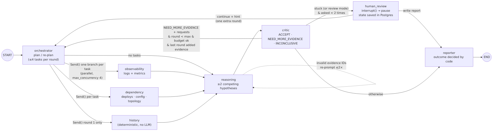

# RootCause Agents 🔍 — Multi-Agent AI for Production Incident Root-Cause Analysis

[](https://github.com/ujjawalkant09/rootcause-agents/actions/workflows/ci.yml)


**Highlights**
- 6 cooperating agents (Orchestrator, Observability, Dependency, Reasoning, Critic, Reporter) on a LangGraph state machine with parallel fan-out and a bounded critic feedback loop
- An evidence ledger where every claim cites a tool-result ID, enforced by code, so facts are separated from assumptions
- Fault-tolerant tooling: retries with backoff, memoisation, budgets, graceful degradation, and fault injection (timeouts, partial or stale data)
- LLM resilience and cost control: a model and provider fallback chain with a circuit breaker, OpenAI prompt caching with cached-token cost accounting, and compact tool payloads (49% smaller)
- **Persistent sessions + human-in-the-loop**: LangGraph Postgres checkpointer (local Docker); the agents pause with `interrupt()` when stuck and resume with your hint
- A **web UI** (Streamlit): pick a test incident or write your own ticket, watch the agents work live, read the report, run the evaluation with a hard spend cap
- **Langfuse observability**: one trace per investigation with typed `agent` / `tool` / `retriever` / `evaluator` observations and a generation (model, tokens, cost) for every LLM call
- An evaluation harness that compares the multi-agent system with a single-agent baseline on accuracy, grounding, tool calls, tokens, cost and latency
- Built test-first: 130+ offline tests using a scripted LLM, plus CI

A LangGraph + OpenAI multi-agent system that investigates production incidents in a simulated environment (logs, metrics, deployments, config changes, service dependencies, incident history), compares competing root-cause hypotheses, challenges them with a critic, and produces an **evidence-backed report**: ranked hypotheses, supporting and contradicting evidence, confidence, facts vs inferences vs assumptions, data gaps, and remediation. An honest **INCONCLUSIVE** is a valid outcome.



The design docs are in [`docs/`](docs/README.md) (architecture and coordination in [`docs/03-architecture.md`](docs/03-architecture.md), PNG diagrams in [`docs/diagrams/`](docs/diagrams/)). Contributor and agent instructions are in [`CLAUDE.md`](CLAUDE.md).

## Quick start

Everything is done in the **web UI**; there is no command-line tool.

1. **Install** [uv](https://docs.astral.sh/uv/getting-started/installation/) (Python ≥3.11 is installed by uv if needed) and, optionally, [Docker Desktop](https://www.docker.com/products/docker-desktop/) for saved sessions.
2. **Configure:** copy `.env.example` to `.env` and put your `OPENAI_API_KEY` in it (optionally Langfuse keys).
3. **Saved sessions (optional):** with Docker running, start the local Postgres once: `docker compose up -d`.
4. **Open the app:** double-click **`start-ui.command`** (macOS). On Windows/Linux run `make app` (or `uv run streamlit run src/rootcause_agents/ui/app.py`). The app opens at http://localhost:8501.

| Page | What you can do |
|---|---|
| **Investigate** | Two steps: *What happened?* (pick one of the 10 sample incidents or describe your own) and *How should we investigate?* (Team of agents · Team (budget) · Single agent, with cost and time shown). Watch a plain-language progress timeline; if the agents get stuck they **ask you in a chat message** (quick replies or a typed hint); then read a result card with tabs for findings, next steps, hypotheses, evidence and cost |
| **Sessions** | *Waiting for you* (answer the agents), *Stopped* (continue from the last checkpoint), *Finished* (open any report in a side panel) |
| **Results** | Multi-agent vs single-agent comparison at a glance; run a new evaluation with a spend cap |
| **Settings** | Connections (OpenAI, Postgres, Langfuse), models and limits |

Custom tickets are investigated against the simulated telemetry of the environment you pick; no real production systems are queried.

**For developers:** `make test` runs the offline test suite (no API key needed), `make lint` runs ruff, and `make live` runs two real-API smoke tests.

### Observability with Langfuse (optional)

Add `LANGFUSE_PUBLIC_KEY`, `LANGFUSE_SECRET_KEY` and `LANGFUSE_BASE_URL` to `.env` (see `.env.example`). Every investigation then becomes one trace, structured following the [Langfuse trace best practices](https://langfuse.com/docs/observability/best-practices):

```
investigate-incident                agent      input: the incident · output: outcome, root cause, confidence
├─ plan-investigation               agent      orchestrator, one per round
├─ observability-agent              agent      one per task, in parallel
│  ├─ observability                 generation every LLM call: prompt, output, model, tokens, cached tokens, cost
│  └─ query_logs / query_metrics    tool       sibling of the generation that requested it
├─ dependency-agent                 agent      (get_deployments, get_config_changes, get_service_dependencies)
├─ search_incident_history          retriever
├─ generate-hypotheses              agent
├─ critique-hypotheses              evaluator  critic decision + issues
└─ write-report                     agent
```

- System and scenario are tags, and an evaluation batch is one session.
- Model fallbacks, LLM errors and degraded nodes are WARNING/ERROR events.
- Scores: `outcome`, `top_confidence`, `cost_usd`, `tool_calls` and `latency_s`.
- Telemetry never breaks a run: without keys it is a no-op, and Langfuse errors are logged and ignored.

Systems:

| System | Description |
|---|---|
| `mas` | Full multi-agent graph. All agents use `MAIN_MODEL` (default `gpt-6.2-sol`) |
| `mas-cheap` | Same graph, but the Observability and Dependency workers use `WORKER_MODEL` (default `gpt-6-luna`) |
| `single` | One ReAct agent with the **same 6 tools, budget, report schema and outcome policy** |

If your key can't access the default models, set `MAIN_MODEL` / `WORKER_MODEL` in `.env` (for example `gpt-6.1-terra`). For models without `json_schema` structured output, set `STRUCTURED_METHOD=function_calling`.

## How it works

```
START → Orchestrator ─Send()→ ┌ Observability (logs, metrics)        ┐
          ↑                   ├ Dependency (deploys, config, graph)   ├→ Reasoning → Critic ─┬→ Reporter → END
          │                   └ History (deterministic search)       ┘                      │
          └──────── NEED_MORE_EVIDENCE (targeted requests, ≤3 rounds, must add new evidence) ┘
```

- **Shared state (blackboard)**: a LangGraph `StateGraph` whose reducers merge an append-only **evidence ledger**, findings, data gaps and critic verdicts from parallel branches.
- **Evidence ledger**: every successful tool call becomes `Evidence` with a code-assigned ID (`E-n`). Hypotheses and claims must cite IDs. A validator rejects unknown IDs, re-prompts the agent (bounded), then sanitises the output. Uncited "facts" are demoted to assumptions.
- **Parallelism**: the `Send` API fans out the specialist tasks, and agents issue parallel tool calls in a single turn.
- **Feedback loop**: the Critic returns `ACCEPT | NEED_MORE_EVIDENCE | INCONCLUSIVE` with structured evidence requests, which the Orchestrator turns into new targeted tasks.
- **Outcome by policy, not by the LLM**: ACCEPT + top confidence ≥0.75 + margin ≥0.2 → `ROOT_CAUSE_IDENTIFIED`; otherwise `PROBABLE`/`INCONCLUSIVE` (`src/rootcause_agents/budget.py`).
- **Reliability**:
  - Tool retries with exponential backoff and jitter for retryable faults.
  - Repeated identical calls are memoised.
  - Budgets on rounds, tool calls, tool turns per agent, tokens and wall-clock time.
  - The loop stops early when a round adds no new evidence.
  - Node-level retry, then graceful degradation (a failed agent becomes a recorded data gap).
  - Deterministic fallbacks for the plan and the report.
  - `recursion_limit` as a final safety net.
- **LLM fallback chain** (`llm.py`): primary model → `FALLBACK_MODELS` → an optional second OpenAI-compatible provider (`FALLBACK_BASE_URL`).
  - It switches on provider errors, timeouts or unparseable structured output.
  - A circuit breaker skips an endpoint after repeated failures, then tries it again after a cooldown.
  - Every fallback is traced and counted in the report.
- **Prompt caching**:
  - Each agent's system message is a stable prefix (role instructions plus the static environment), and all incident-specific content comes after it.
  - Tool loops only ever append messages, so later turns reuse the cached prefix.
  - Each role sends a `prompt_cache_key`.
  - Cached tokens are read from the API response and priced at the cached rate (5% of the normal input price for `gpt-6.2-sol`).
- **Token diet**:
  - Tools return error clusters and change points, never raw logs.
  - The model receives a compact version of each tool result (no metric series, one sample line per log cluster). That is 49% fewer characters across all scenarios, while the full data stays in the evidence ledger.
  - Per-agent token and cost breakdown appears in every report and in the evaluation summary.
- **Smart tools**: logs come back as error-signature clusters and metrics as change-point onsets and magnitudes, never as raw dumps. This keeps tokens low and signal high.
- **Fault injection** (declared per scenario, seeded): timeouts, unavailable backends, rate limits, partial shards, stale metrics, empty results.

## Results

10 incidents × 3 systems, 1 run each, total cost **$2.02** ([full analysis](docs/EVALUATION_RESULTS.md) · [raw tables](eval/results/summary.md) · [technical note](docs/TECHNICAL_NOTE.md)).

| | mas | mas-cheap | single |
|---|---|---|---|
| Top-1 root-cause accuracy | **10/10** | 9/10 | **10/10** |
| Outcome correctness | **10/10** | 8/10 | 8/10 |
| Citation validity / key-evidence recall | 100% / 100% | 100% / 100% | 100% / 100% |
| Tool calls (mean) | 34.7 | 35.1 | 39.3 |
| Tokens in / out (mean) | 59k / 11k | 60k / 15k | 25k / 3k |
| Latency (mean) | 147 s | 159 s | **51 s** |
| Cost per incident | $0.109 | $0.057 | **$0.036** |

**Takeaway:** on this dataset, a single agent with the same pre-aggregating tools is as accurate and about 3× cheaper. The multi-agent critic loop turned two "inconclusive" answers (misleading and tool-failure cases) into correct conclusions. With n=10 this is indicative, not significant.

## Dataset & evaluation

`data/scenarios/S01–S10` cover: a control case, misleading coincident deploys, misleading history priors, conflicting observations, noisy chronic errors, tool failures (timeouts, partial, stale, unavailable) and an expected-inconclusive case. Ground truth is read **only** by the simulator and the grader. `tests/test_no_hardcoding.py` enforces that agent code and prompts never reference scenarios, and `tests/test_dataset.py` proves every scenario's key signals are discoverable through the tools.

Metrics (computed from reports and traces):
- top-1 and top-3 root-cause accuracy, outcome correctness, confident-wrong rate
- citation validity, claim coverage, key-evidence recall
- Brier score
- rounds, tool calls, LLM calls, tokens (including cache hit rate and per-agent breakdown), cost (USD, cached-token aware) and latency

Results go to `eval/results/summary.md`, plus per-run reports and traces under `eval/results/runs/`.

## Project layout

```
src/rootcause_agents/   config, schemas, llm, budget, validation, graph, runner, evaluation, persistence, telemetry
  ui/              Streamlit app: app.py, app_pages/ (investigate, sessions, results, settings), common.py, jobs.py, view.py
  agents/          orchestrator, specialists, reasoning, critic, reporter, single_agent, tool_loop
  tools/           impl (6 tools), executor (retry/memo/evidence/budget), faults, analytics
  sim/             scenario models, generator, store
  prompts/         system prompts (generic)
data/              topology, incident history, scenarios
tests/             offline pytest suite (scripted LLM); `-m live` for real API smoke tests
eval/results/      evaluation summary (run new evaluations from the Results page)
docs/              design docs
```

## External dependencies
- **OpenAI API** (via `langchain-openai`) for live runs and evaluation. Needs `OPENAI_API_KEY` and network access.
- Python packages: `langgraph`, `langchain-openai`, `langchain-core`, `pydantic`, `numpy`, `pyyaml`, `python-dotenv`. Dev: `pytest`, `pytest-asyncio`, `ruff`.
- UI: `streamlit`, `pandas`. Observability: `langfuse` (v5, optional at runtime).
- Optional: Docker (local Postgres 16 for persistent sessions; `langgraph-checkpoint-postgres`, `psycopg`). Without it, sessions are in-memory. Langfuse Cloud is used only if you add its keys.

## Limitations / incomplete functionality
- The telemetry is synthetic, generated from declared causal signals, so it is cleaner than real production data.
- 10 scenarios × 1 run each, so results are indicative rather than statistically significant.
- Grounding is measured by code (citation validity, claim coverage, key-evidence recall). There is no LLM-judge "semantic support" score yet.
- Confidence comes from the LLM and is uncalibrated.
- Human-in-the-loop resumes rebuild the run context from the checkpoint; wall-clock time spent waiting for the human is not counted in latency.
- Pricing for cost estimates is hard-coded in `config.py` (checked 2026-11-19).
