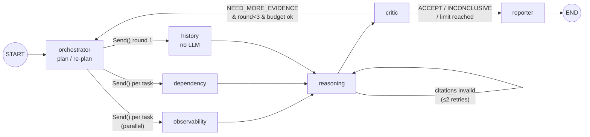
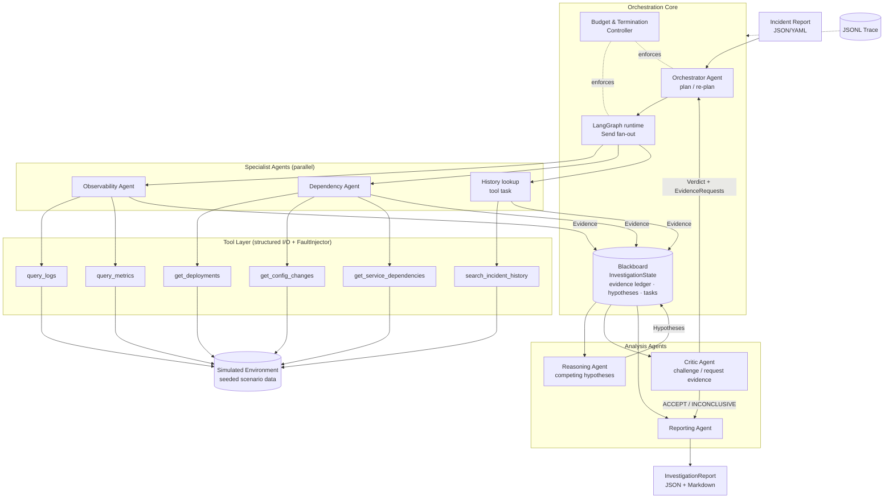
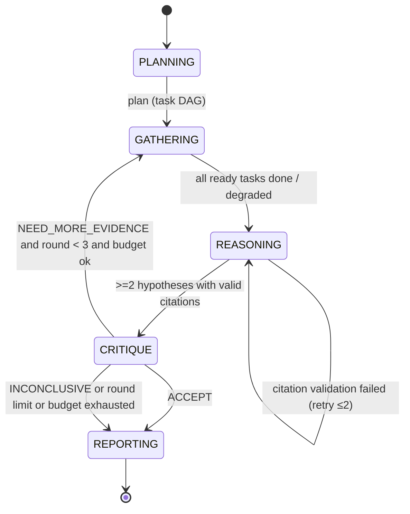
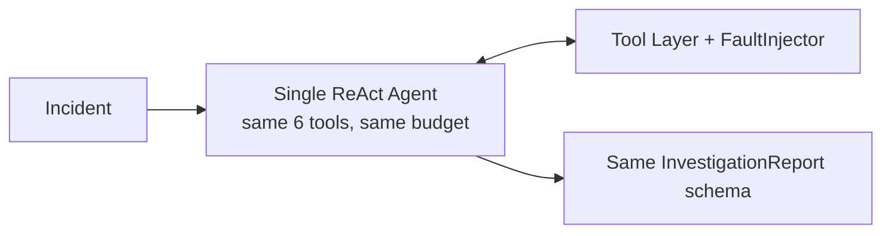

# 03 – Architecture & Agent Coordination

> Implementation: **LangGraph `StateGraph`** with OpenAI models. The diagrams below show the logical design, and §0 shows the actual graph.

## 0. LangGraph graph (what will be implemented)



```python
# sketch – src/rootcause_agents/graph.py
import operator
from typing import Annotated, TypedDict
from langgraph.graph import StateGraph, START, END
from langgraph.types import Send, RetryPolicy

class InvestigationState(TypedDict):
    incident: IncidentReport
    plan: list[Task]
    evidence: Annotated[list[Evidence], operator.add]       # parallel branches merge
    findings: Annotated[list[SpecialistFindings], operator.add]
    data_gaps: Annotated[list[str], operator.add]
    hypotheses: list[Hypothesis]
    verdicts: Annotated[list[CriticVerdict], operator.add]
    round: int
    usage: Annotated[list[UsageRecord], operator.add]      # tokens / tool calls per node
    report: InvestigationReport | None

def fan_out(state):        # router after orchestrator
    return [Send(t.agent, {"task": t, "incident": state["incident"]}) for t in state["plan"]]

def after_critic(state):   # termination controller
    v = state["verdicts"][-1]
    if v.decision == "NEED_MORE_EVIDENCE" and state["round"] < MAX_ROUNDS and budget_ok(state):
        return "orchestrator"
    return "reporter"

retry = RetryPolicy(max_attempts=3)
g = StateGraph(InvestigationState)
g.add_node("orchestrator", orchestrator_node, retry_policy=retry)
g.add_node("observability", observability_node, retry_policy=retry)
g.add_node("dependency", dependency_node, retry_policy=retry)
g.add_node("history", history_node)
g.add_node("reasoning", reasoning_node, retry_policy=retry)
g.add_node("critic", critic_node, retry_policy=retry)
g.add_node("reporter", reporter_node, retry_policy=retry)
g.add_edge(START, "orchestrator")
g.add_conditional_edges("orchestrator", fan_out, ["observability", "dependency", "history"])
for n in ("observability", "dependency", "history"):
    g.add_edge(n, "reasoning")
g.add_edge("reasoning", "critic")
g.add_conditional_edges("critic", after_critic, ["orchestrator", "reporter"])
g.add_edge("reporter", END)
graph = g.compile()
# run: graph.invoke({"incident": inc, "round": 0}, {"recursion_limit": 40})
```

> Exact LangGraph signatures (e.g. `RetryPolicy` fields) will be checked against the installed version during implementation.

## 1. High-level component diagram (logical)



## 2. Investigation lifecycle (state machine)



## 3. Sequence: one investigation including the feedback loop


This sequence also shows a typical *misleading evidence* scenario: a deploy coincides with the incident but is not the cause.

## 4. Coordination model, explained

**Pattern:** a hybrid of *orchestrator–workers* (dynamic task decomposition) and *evaluator–optimizer* (Critic feedback loop) over a shared *blackboard*.

1. **The Orchestrator plans once and re-plans after every Critic verdict.** Its output is a typed `InvestigationPlan`: a list of `Task{id, agent, objective, params_hint, depends_on, priority}`. It never calls tools directly.
2. **LangGraph executes the plan.** The `Send` API fans out one branch per task, and the branches run concurrently in the same superstep. Each task has a timeout and a retry policy, and a failure is recorded on the blackboard without crashing the run.
3. **Specialists are tool-using agents.** Each one runs a short bounded tool loop (at most 6 tool turns) against *its own* subset of tools. It emits `Evidence` records plus a short `Findings` summary with explicit *gaps* ("metrics for `inventory` unavailable – timeout ×3").
4. **The Reasoning Agent sees only the blackboard**: evidence summaries, gaps and prior critiques. It does not see raw transcripts. It outputs ranked hypotheses that cite evidence IDs.
5. **Code validates citations** before the Critic sees anything (invalid IDs trigger a re-prompt).
6. **The Critic** checks for anchoring, temporal ordering (cause must precede effect), unexplained symptoms, conflicting evidence and missing data. It returns a verdict plus *specific* evidence requests.
7. **The termination controller** decides whether to loop again or report (see 06).
8. **The Reporting Agent** turns the final blackboard into the report. It is not allowed to introduce new claims; a code check verifies that every cited ID exists.

### Why this is "genuine collaboration" and not a prompt chain
- The control flow is **data-dependent**. The Critic's output changes which agents run next and with what objectives.
- Agents **communicate through typed artifacts on a shared state**, not by passing free-text transcripts.
- Specialists report **gaps and conflicts**, and these drive the Reasoning and Critic behaviour.
- The number of rounds, tasks and tool calls varies by incident. Easy incidents finish in 1 round; adversarial ones take 2–3.

## 5. Single-agent baseline (for comparison)



The baseline uses the same tool registry, fault injection seed, model, budget caps and output schema. Only the architecture differs.
