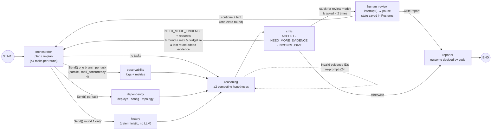
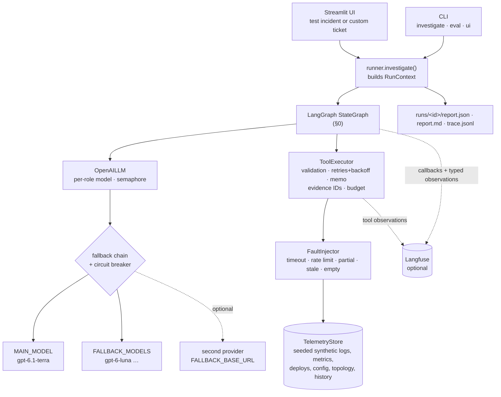
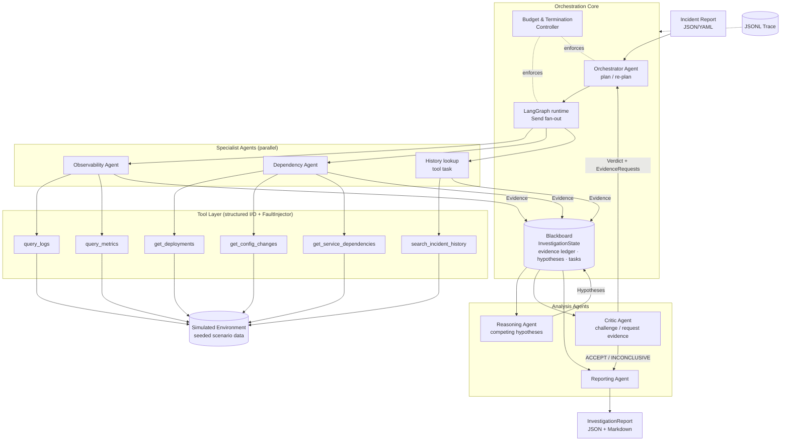
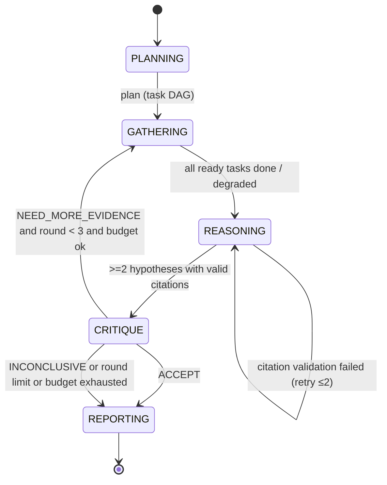
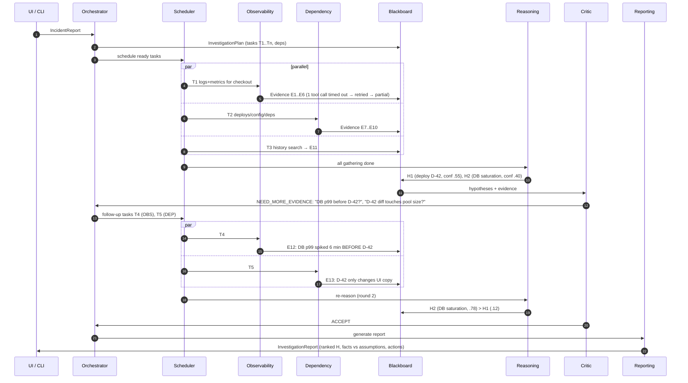
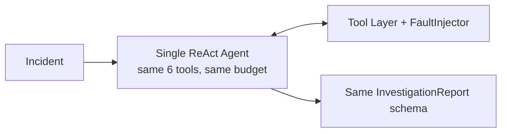

# 03 – Architecture & Agent Coordination

> Implementation: **LangGraph `StateGraph`** (`src/rootcause_agents/graph.py`) with OpenAI models via `langchain-openai`. §0 is the graph exactly as built, §0.1 the runtime around it, §1–3 the logical design.

## 0. LangGraph graph (as implemented)

Image: [`diagrams/01-langgraph-graph.png`](diagrams/01-langgraph-graph.png) (all diagrams are also exported as PNG in [`docs/diagrams/`](diagrams/), with `.mmd` sources).

**Persistence and human-in-the-loop.** The graph is compiled with a LangGraph checkpointer (`AsyncPostgresSaver` on the local Docker Postgres, or in-memory without `DATABASE_URL`), and each investigation is a thread (`thread_id` = run id) checkpointed after every super-step. In `stuck` mode, when the critic cannot conclude, `human_review` calls `interrupt()`: the run pauses and the question (top hypotheses, critic issues) is shown in the UI. `resume_session` rebuilds the run context from the checkpoint (seeded simulator, restored budget and evidence counters, so it works from a new process) and continues with `Command(resume=answer)`. A human hint is passed to later agents as a *lead to verify with tools*. It is never citable evidence, and it appears in the report under "Human input". Each run asks at most 2 times, and evaluation runs never pause. Checkpoint deserialization uses an explicit allowlist of our schema classes.

**Shared state** (`InvestigationState`, a `TypedDict` with reducers so parallel branches merge safely):

| Key | Reducer | Written by |
|---|---|---|
| `evidence: list[Evidence]` | `merge_evidence` (dedupe by code-assigned `E-n` id) | specialists, history |
| `findings: list[SpecialistFindings]` | append | specialists |
| `data_gaps: list[str]` | append | any node, tool failures |
| `plan: list[Task]` (`agent, objective, services, rationale`) | replace | orchestrator |
| `hypotheses: list[Hypothesis]` | replace | reasoning |
| `verdicts: list[CriticVerdict]` | append | critic |
| `round`, `evidence_at_round_start` | replace | orchestrator |
| `report: InvestigationReport` | replace | reporter |

**Task dependencies** are structural: specialists depend only on the plan, so they run in parallel; reasoning waits for *all* branches of the round (LangGraph superstep barrier); the critic depends on reasoning; the next round depends on the critic's evidence requests, which the orchestrator turns into new tasks.

**Reliability inside the graph:**
- every node runs in `_resilient`: 2 attempts, then it degrades (a gap is recorded and the run continues);
- the tool loop is bounded: ≤6 LLM turns and ≤8 tool calls per task (`max_tool_calls_per_task`, which keeps budget for follow-up rounds);
- global budget: ≤40 tool calls, 400k tokens, 420 s and `max_rounds` (default 2 in `.env`), with `recursion_limit=60` as a final net;
- the outcome comes from `budget.decide_outcome`: ACCEPT + top ≥0.75 + margin ≥0.2 → ROOT_CAUSE_IDENTIFIED; ACCEPT → PROBABLE; else INCONCLUSIVE.

## 0.1 Runtime view (what surrounds the graph)

Image: [`diagrams/02-runtime.png`](diagrams/02-runtime.png)

- **Prompt caching:** system prompt = instructions + static environment only, plus `prompt_cache_key` per role. Cached tokens are priced at the cached rate.
- **Token diet:** tool results reach the model compacted (`compact_data`), while the ledger keeps the full data.
- **Observability:** one Langfuse trace per run (`investigate-incident`), with `agent` / `tool` / `retriever` / `evaluator` observations, a generation per LLM call, and scores for outcome, confidence, cost, tool calls and latency. See the README.

## 1. High-level component diagram (logical)

## 2. Investigation lifecycle (state machine)

## 3. Sequence: one investigation including the feedback loop

This sequence also shows a typical *misleading evidence* scenario: a deploy coincides with the incident but is not the cause.

## 4. Coordination model, explained

**Pattern:** a hybrid of *orchestrator–workers* (dynamic task decomposition) and *evaluator–optimizer* (Critic feedback loop) over a shared *blackboard*.

1. **The Orchestrator plans once and re-plans after every Critic verdict.** Its output is a typed `InvestigationPlan`: a list of `Task{agent, objective, services, rationale}` (at most 4 per round). It never calls tools directly.
2. **LangGraph executes the plan.** The `Send` API fans out one branch per task, and the branches run concurrently in the same superstep. Each node gets 2 attempts; a final failure is recorded as a data gap without crashing the run.
3. **Specialists are tool-using agents.** Each one runs a short bounded tool loop (at most 6 LLM turns and 8 tool calls per task) against *its own* subset of tools. It emits `Evidence` records plus a short `Findings` summary with explicit *gaps* ("metrics for `inventory` unavailable – timeout ×3").
4. **The Reasoning Agent sees only the blackboard**: evidence summaries, gaps and prior critiques. It does not see raw transcripts. It outputs ranked hypotheses that cite evidence IDs.
5. **Code validates citations** before the Critic sees anything (invalid IDs trigger a re-prompt).
6. **The Critic** checks for anchoring, temporal ordering (cause must precede effect), unexplained symptoms, conflicting evidence and missing data. It returns a verdict plus *specific* evidence requests.
7. **The termination controller** (`after_critic` + `should_continue`) loops back only if the Critic asked for specific evidence, rounds and budget remain, and the last round added new evidence; otherwise it reports (see 06).
8. **The Reporting Agent** turns the final blackboard into the report. It is not allowed to introduce new claims; a code check verifies that every cited ID exists.

### Why this is "genuine collaboration" and not a prompt chain
- The control flow is **data-dependent**. The Critic's output changes which agents run next and with what objectives.
- Agents **communicate through typed artifacts on a shared state**, not by passing free-text transcripts.
- Specialists report **gaps and conflicts**, and these drive the Reasoning and Critic behaviour.
- The number of rounds, tasks and tool calls varies by incident. Easy incidents finish in 1 round; adversarial ones take 2–3.

## 5. Single-agent baseline (for comparison)

The baseline uses the same tool registry, fault injection seed, model, budget caps and output schema. Only the architecture differs.
